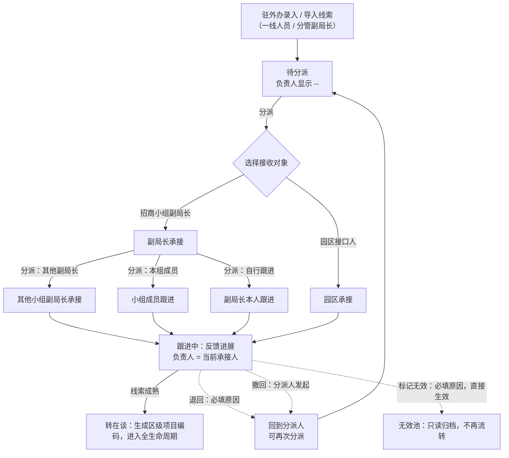

# 驻外线索模块 - 需求设计

> 版本：v1.2　|　日期：2026-11-17　|　状态：已确认（22 条决策全部闭环；见文末待确认项汇总）
> 关联：DEMO 已实现（`pages/Zhuwai.jsx` / `pages/ZhuwaiDetail.jsx` / `components/TransferToZaitanModal.jsx`）；角色权限配置归《角色权限配置表》

## 1. 背景与目标

三个驻外招商机构（驻长三角招商小组、驻京津冀招商小组、驻粤港澳大湾区招商小组）将挖掘的投资线索统一归集至平台，经**分派**交由招商小组或园区跟进，成熟后**转为在谈项目**进入全生命周期管理（在谈 → 签约 → 落地）。

本模块是全生命周期的「第 0 阶段」入口，核心链路：

```
线索归集（申报/导入） → 分派（招商小组 / 园区） → 跟进 → 转在谈（生成区级项目编码） → 后续全周期
```

文档分两部分：**第 2 节**为 DEMO 已实现现状梳理（字段级），**第 3 节**为本次设计补充的业务规则细化（线索分派 / 转项目继承 / 线索转化统计），供真实开发参考。

## 2. 现状梳理（DEMO 已实现）

### 2.1 页面与入口

| 项 | 说明 |
|----|------|
| 菜单入口 | 线索管理 → 驻外线索（`/project/zhuwai`） |
| 列表页 | 统计卡片（转化漏斗）+ 筛选栏 + 线索表格，复用 `GenericProjectList` |
| 详情页 | `/project/zhuwai/detail/:id`，头部操作 + Descriptions 基础信息（2 列，无 Tab） |

### 2.2 统计卡片（转化漏斗，6 张单行排列）

| 卡片 | 口径 | 配色 |
|------|------|------|
| 本周新增（居首） | 历史基数 4 + 会话内新增/导入数 | 蓝 |
| 累计线索 | 历史基数 50 + 当前列表总数 | 蓝 |
| 已分派 | 历史基数 18 + 当前跟进中/无效数 + 会话内转出数 | 蓝 |
| 转在谈 | 历史基数 5 + 会话内转出数 | 蓝 |
| 签约 | mock：3 个 / 金额 12.5 亿元 | 绿 |
| 落地 | mock：1 个 / 金额 8.0 亿元 | 橙 |

数字与金额同行展示（`N 条 | 金额 X 亿元`），沿用统计看板卡片样式。

### 2.3 列表列与操作

**列**（scrollX 1620）：序号（55px 固定左）、线索编码、申报人（固定左，三个驻外招商小组）、项目名称（蓝色链接进详情）、产业类别、行业类别、来源地、计划投资总额(亿元)、**线索状态**（Tag：待分派灰/跟进中蓝/无效红；已转化已移出不展示）、**当前负责人**（待分派显示「--」，跟进中显示承接人，悬浮显示分派时间）、申报时间、操作（200px 固定右）。

> 2026-11-17 确认：**线索阶段不需要「责任单位」**（责任单位在转在谈时新填），列表列、表单、详情页均已移除该字段。

**操作列**（按线索状态显示；跟踪洽谈列表风格）：

| 线索状态 | 直接按钮 | 「更多」下拉 |
|----------|----------|--------------|
| 待分派 | 详情、分派 | 转在谈、删除线索 |
| 跟进中 | 详情、撤回（分派人视角，demo 恒显） | 退回、标记无效、转在谈、删除线索 |
| 无效 | 详情（只读归档） | — |

> 撤回（分派人）与退回（承接方）按角色互斥，真实系统按当前登录角色显示其一；DEMO 单视角恒显演示。

### 2.4 新增驻外线索表单（960px 弹窗，两列栅格、标签居左）

| 字段 | 控件 | 必填 | 说明 |
|------|------|------|------|
| 项目名称 | Input | ✅ | ≤40 字 |
| 内外资 | Select（内资/外资） | ✅ | 联动来源地选项，切换时清空来源地 |
| 来源地 | Cascader | ✅ | 内资：34 省级行政区 → 城市（二级）；外资：36 个国家（单级）；未选内外资时禁用 |
| 产业类别 | Select（农业/工业/服务业） | ✅ | |
| 行业类别 | Cascader | ✅ | 门类 → 大类两级（26 个门类，源自 Excel 字段表） |
| 计划投资总额(亿元) | InputNumber | ✅ | >0，两位小数 |
| 项目简介 | TextArea | ✅ | ≤999 字，计数显示 |

提交**直接保存**（2026-11-17 确认：线索新增 / 导入不做判重，见 2.8 说明）；保存时自动生成线索编码，申报人 = 当前用户（驻外小组），状态 = 待分派。

### 2.5 导入线索（三阶段弹窗，无判重）

`上传 → 解析中（1.5s）→ 完成`。一次 mock 导入 8 条线索（置顶插入列表），提示「导入不做冲突判重」；提供模板下载入口（demo 示意）。导入线索自动生成线索编码，申报人 = 批量导入，状态 = **待分派**（负责人显示 --）。

### 2.6 分派 / 撤回 / 退回 / 标记无效（已按 3.1 定稿实现）

| 项 | 说明 |
|----|------|
| 分派对象 | 分组下拉：**招商小组副局长**（半导体组·容伟、化合物半导体组·周玲玲、人工智能组·余萌、智能终端组·汪超、生命健康组·黄琳）＋ **园区接口人**（未来科技城、光谷生物城、光谷中心城、东湖综合保税区、光电园、服务业园、智造园、中华园） |
| 分派弹窗 | 分派对象（必填单选）＋ 分派备注（选填 ≤200 字）；成功 → 状态「跟进中」、当前负责人 = 承接人、进展信息写入系统事件 |
| 撤回弹窗 | 提示原承接对象与时间 + 撤回备注（选填）；→ 回「待分派」（负责人 --），可再次分派 |
| 退回弹窗 | 退回原因（**必填** ≤200 字）；→ 退回至分派人，回「待分派」，可再次分派 |
| 标记无效弹窗 | 无效原因（**必填** ≤200 字，直接生效不复核）；→「无效」只读归档（操作列仅剩详情） |
| 筛选 | 顶部筛选行支持按「线索状态」筛选（待分派/跟进中/无效） |

### 2.7 转在谈（`TransferToZaitanModal`）

入口：列表「更多 → 转在谈」、详情页「转在谈」按钮，均先二次确认（「需要补充在谈阶段必填字段」）。

弹窗字段分三类：

| 类别 | 字段 |
|------|------|
| 继承只读 | 线索编码（`codeLabel/codeValue` 传入，disabled 展示 XW 码） |
| 预填可改 | 项目名称、内外资、来源地、产业类别、行业类别、计划投资总额、项目简介 |
| 需新填（在谈必填） | **责任单位**（≥1 个，分组下拉）、项目分类、需投资金额、投资主体、对接时间、是否为存量企业、是否飞地园区、是否产业外溢；选填：次要行业类别、企业类别、注册资本、楚商类型 |

成功后：生成**区级项目编码**、线索移出驻外线索列表、提示并跳转在谈列表。转在谈环节判重保留（见 2.8）。

### 2.8 判重

> **2026-11-17 确认口径并已落地：驻外线索的新增 / 导入不做判重**（线索阶段重名常见，由后续转在谈环节把关）。新增表单与导入流程中的四级判重逻辑（L1 阻断 / L2·L3 二选一 / L4 弱提示）已移除；**转在谈环节的判重保留**（避免线索转化项目与存量项目重复）。

### 2.9 详情页

- 头部：返回（text 按钮）+ 项目名称 + 线索状态 Tag（待分派/跟进中）；操作按钮：**分派 / 进展汇报 / 编辑 / 转在谈 / 更多**（更多下拉：撤回分派、退回、标记无效、删除线索；demo 恒显演示，真实系统按角色与状态显示）
- **双 Tab 结构**（2026-11-17 确认沿用项目谋划详情页设计）：「基础信息」+「进展信息」两个 Tab；「进展汇报」按钮在头部右上角
- 进展信息 Tab：系统动作流水（流入 / 分派 / 撤回 / 退回 / 无效 / 转在谈，系统事件样式）与人工汇报混排时间线（最近在上）；人工汇报可编辑 / 删除（限本人），系统事件不可操作
- 基础信息 Descriptions（bordered，2 列）：线索编码、项目名称、计划投资总额(亿元)、内外资、来源地、产业类别、行业类别、申报人、申报时间、项目简介（跨 2 列）
- 编辑弹窗：字段同新增表单
- 已移除：AI 摘要模块

### 2.10 编码与数据存储

| 项 | 规则 |
|----|------|
| 线索编码 | `XW + YYYYMMDD + 3位流水`（如 XW20261105001），新增/导入时系统生成；线索阶段唯一标识 |
| 区级项目编码 | 仅转在谈成功后生成（`generateDistrictCode()`） |
| mock 数据源 | `data.json` zaitan 前 4 条（申报人 = 三个驻外招商小组）+ 会话内新增/导入；预设状态：第 1、3 条跟进中、第 2 条待分派、第 4 条无效 |
| 持久化 | 内存态（刷新重置）；分派与状态记录同 |

## 3. 业务规则细化（本次设计补充，供真实开发）

> 以下规则 DEMO 未实现或仅部分体现，标注默认口径，**待确认后生效**。

### 3.1 线索分派规则（统一「分派」动作）

> 2026-11-17 讨论确认：原「分发 / 转派 / 指派」三个概念统一为**分派**。对操作者而言都是「把线索交给某个对象跟进」，差异只在接收对象；是否首次分派、是指派还是转派由系统按上下文自动标注留痕，界面与话术不再区分。**「退回」与「标记无效」为两个独立动作**：退回 = 回到分派人重新分派（流转动作）；标记无效 = 归档不再流转（终态动作）；「自行跟进」实现为分派的特殊形式（接收人 = 自己）。

**权限体系分工**（2026-11-17 确认的文档架构原则，避免 PRD 与权限表重复）：

| 层 | 载体 | 职责 |
|----|------|------|
| 权限字典 | 《角色权限配置表》（独立维护） | 角色定义、角色 ↔ 权限点勾选、数据可见范围（组织调整时只改这里） |
| 业务规则 | 本 PRD | 每个动作的业务规则（必填、流向、状态变化）；动作只标**权限点 code**，不展开角色 |
| 条件规则 | 本 PRD | 「权限点 + 关系条件」规则（如小组成员仅可转在谈**自己承接**的线索）——属业务逻辑，权限表无法表达 |

> 研发实现：按钮显隐查权限点（读权限配置）→ 动作行为与条件判断查本 PRD。本节「可用角色」列仅为速查，**配置以权限表为准**。

**动作与权限点清单**：

| 动作 | 权限点 | 业务规则（本节定义） | 可用角色（速查，以权限表为准） |
|------|--------|---------------------|-------------------------------|
| 新增 / 导入线索 | `clue:create` | 不判重；自动生成 XW 线索编码；申报人 = 当前用户 | 驻外办一线人员、驻外办分管副局长 |
| 分派 | `clue:assign` | 接收对象按角色分组下拉（副局长/园区接口人/本组成员/自己）；**UI 一律呈现「分派」**，系统自动标注类型便于审计，不再区分「首派 / 再派」等叫法（2026-11-17 确认） | 驻外办一线人员、驻外办分管副局长、招商小组副局长 |
| 编辑线索 | `clue:edit` | **待分派**：申报驻外办可编辑；**跟进中**：当前**承接链**（副局长 / 小组成员 / 园区接口人）均可编辑（2026-11-17 确认开放），申报驻外办只读 | 申报驻外办（待分派时）、承接链（跟进中：副局长 / 小组成员 / 园区接口人） |
| 退回 | `clue:return` | 必填原因；回到分派人（上一棒），状态回「待分派」；双方收通知 | 招商小组副局长、园区接口人 |
| 撤回 | `clue:withdraw` | **谁分派的线索谁可撤回**（2026-11-17 确认）：承接方尚未转在谈 / 标记无效时，分派人可撤回自己的分派（可填备注）；撤回后状态回「待分派」，可再次分派 | 各级分派人（驻外办、副局长，限自己发出的分派） |
| 标记无效 | `clue:invalidate` | 必填原因；直接生效不复核；进无效池只读归档、不提供重新启用 | 招商小组副局长、园区接口人 |
| 转在谈 | `clue:transfer` | 经转在谈弹窗补录在谈必填字段；生成区级项目编码；线索转「已转化」；**条件规则**：小组成员仅可转在谈**自己承接**的线索；园区接口人仅可转在谈**本园区承接**的线索；副局长可转在谈**本小组全部**线索 | 招商小组副局长、小组成员（条件）、园区接口人（条件） |

> **无「改派」**（2026-11-17 确认移除）：管理员不参与调整承接对象；线索流转调整一律走「退回」或「撤回」后重新分派。

> **数据可见范围**（`clue:view:*`，配置归权限表；2026-11-17 确认「精细分人」）：驻外办一线人员 = **仅自己申报**的线索；驻外办分管副局长 = 本机构全部申报线索（可操作：代分派 / 编辑，应对出差轮岗）；小组成员 = 本小组承接线索；副局长 = 本小组线索；园区接口人 = 本园区承接线索；管理员 = 全量。
> **已转化项目跟踪**：线索转在谈后移出驻外线索列表；驻外办可在**项目管理列表（在谈/签约/落地）**中跟踪由本机构线索转化的项目进度，**只读、无任何操作按钮**。

> **删除线索**：DEMO 演示功能。真实系统**不提供物理删除**（留痕要求），以「标记无效」归档替代。

**业务流程图**：



**线索状态枚举**（真实开发状态机字段，DEMO 现仅两态「分发状态」需扩充）：

| 状态 | 含义 | 进入条件 | 可用动作 |
|------|------|----------|----------|
| 待分派 | 新录入 / 被退回 / 被撤回，**负责人显示「--」**（2026-11-17 确认）；系统内部记录持有人（申报驻外办或分派人）用于操作权判断 | 新增、导入、退回、撤回 | 分派、编辑（持有人） |
| 跟进中 | 已有承接对象（含副局长本人跟进） | 分派成功 | 进展汇报、编辑（承接链）、转在谈、退回、标记无效、撤回（分派人）、分派（副局长） |
| 已转化 | 转为在谈项目 | 转在谈成功 | **线索移出驻外线索列表**（2026-11-17 确认）；项目进度由驻外办在项目管理列表只读跟踪 |
| 无效 | 无效池归档 | 标记无效 | 只读 |

**分派动作矩阵**（分派成功即进入「跟进中」）：

| 当前持有人 | 动作 | 可选接收对象 | 分派后状态 |
|------------|------|--------------|------------|
| 驻外办一线人员 / 分管副局长 | 分派 | 招商小组副局长 / 园区接口人 | 跟进中 |
| 招商小组副局长 | 分派 | 本组成员 / 自己（自行跟进）/ 其他小组副局长 / 园区接口人 | 跟进中 |
| 小组成员 | — | 不可分派（自己跟进的线索可直接转在谈） | — |
| 园区接口人 | — | 不可分派（如需调整由原分派人**撤回**后重新分派） | — |

> **副局长层级均可分派**（2026-11-17 确认）：第一轮承接驻外办分派的副局长可退回、标记无效；线索分派给其他小组副局长承接后，该副局长依然可以分派给其他小组小组成员、其他小组副局长、园区，或自行跟进——凡以副局长身份承接的线索，均拥有完整分派能力。

**退回与标记无效**（两个独立动作，2026-11-17 确认）：

| 动作 | 发起人 | 流向 | 规则 |
|------|--------|------|------|
| **退回** | 招商小组副局长 / 园区接口人 | 回到**分派人**（上一棒），状态回到「待分派」 | 必填退回原因；分派人可**再次分派**或修改线索；双方收站内通知；全程留痕 |
| **标记无效** | 招商小组副局长 / 园区接口人 | **无效池只读归档**，不再做任何动作、不提供重新启用 | 必填无效原因；直接生效不做复核；申报驻外办收站内通知 |

> 小组成员不可退回 / 标记无效（默认口径）：向副局长反馈，由副局长决定退回或标记无效。
> 第一轮承接驻外办分派的副局长同样可退回、标记无效（2026-11-17 确认）。**谁分派的线索，被对方退回或自行撤回后，均可再次分派**（2026-11-17 确认）。

**分派记录统一模型**（真实开发数据结构）：

```js
// 每次分派写一条记录；type 仅为系统内部审计标注，界面与按钮一律呈现「分派」（2026-11-17 确认，不再出现「再分派」等第二名词）
{
  clueId, from, to,            // 操作人与接收对象（副局长/园区接口人/本组成员/自己）
  type: '首派'|'转派'|'指派本人', // 系统按上下文自动判定，仅用于审计留痕，UI 不展示
  remark, time,
}
```

**当前负责人**（2026-11-17 确认：列表需标明，真实开发新增列）：

| 线索状态 | 当前负责人显示 |
|----------|----------------|
| 待分派 | **--**（2026-11-17 确认；系统内部另记持有人 = 申报驻外办或分派人，用于操作权判断，不对外展示） |
| 跟进中 | 当前承接对象（副局长 / 小组成员 / 园区接口人） |
| 已转化 | 线索已移出列表，项目进度在项目管理列表跟踪（驻外办只读） |
| 无效 | 归档前承接对象（只读） |

> DEMO 现有「分发对象」列可演进为「当前负责人」列：随分派、退回、撤回实时更新；承接方视角据此过滤「分派给我的线索」。

**进展信息机制**（2026-11-17 二次确认：**要做**，此前「待定」结论作废；系统动作流水 + 人工进展汇报双轨记录）：

| 项 | 规则 |
|----|------|
| 记录构成 | ① **系统动作流水**（自动写入）：流入（申报 / 导入）、分派、撤回、退回、标记无效、转在谈等**全部动作**，含操作人、时间、备注 / 原因；② **人工进展汇报**（手动追加）：承接方填写的跟进情况 |
| 汇报入口 | 线索详情页**头部右上角**「进展汇报」按钮（`clue:edit` 权限，承接链可用）；进展内容必填 ≤500 字；人工汇报可编辑 / 删除（限本人） |
| 呈现 | 详情页「进展信息」**独立 Tab**（沿用项目谋划详情页双 Tab 结构），动作流水与人工汇报混排时间线（最近在上） |
| 作用 | ① 全程留痕；② 申报驻外办可见线索跟进进度，不必线下追问 |
| 可见性 | 线索全链路角色可见 |
| 转项目带入 | **转在谈时进展信息全部带入**在谈项目（2026-11-17 确认），在项目详情进展时间线延续展示 |

> 催办：2026-11-17 确认**暂不考虑**（原 5/10 工作日两级催办方案作废，后续如有需要再设计）。

**通知矩阵**（站内信，各动作触发的消息汇总）：

| 触发动作 | 通知对象 | 内容要点 |
|----------|----------|----------|
| 分派 | 接收对象 | 你有新线索待跟进（线索名、申报驻外办、分派人） |
| 撤回 | 被撤回的承接对象 | 你承接的线索已被分派人撤回（线索名、撤回人） |
| 退回 | 分派人（上一棒） | 线索被退回 + 退回原因 |
| 标记无效 | 申报驻外办 | 线索被标记无效 + 无效原因 |
| 转在谈成功 | 申报驻外办 | 你申报的线索已转为在谈项目（含区级项目编码，可在项目管理列表跟踪） |

### 3.2 转项目继承与流转留痕

**编码映射**：线索编码（XW）终身保留于项目档案，作为溯源标识；转在谈时生成区级项目编码，两码关联存储。

**字段继承**（与 2.7 一致）：

| 继承方式 | 字段 | 真实开发建议 |
|----------|------|--------------|
| 只读继承 | 线索编码 | 只读展示，不可改 |
| 预填可改 | 项目名称、内外资、来源地、产业类别、行业类别、计划投资总额、项目简介 | 转化时可修正（如线索阶段信息不全） |
| 必须新填 | **责任单位**、项目分类、投资主体、对接时间、是否存量企业、是否飞地、是否产业外溢 | 在谈阶段业务必填（责任单位线索阶段不填，转在谈时指定） |

**流转留痕（建议）**：转在谈成功后，在谈项目详情进展时间线自动写入系统事件：

> 「项目由驻外线索 {线索编码} 转入，原申报人：{申报人}，分派至：{承接方}，转入经办人：{操作人}」

同时向**原申报驻外办**推送站内消息「您申报的线索已转为在谈项目」，形成申报端闭环。**已转化线索移出驻外线索列表**（2026-11-17 确认，与 DEMO 一致）；驻外办后续在**项目管理列表**只读跟踪项目进度（无任何操作按钮，见 3.1 数据可见范围）。

**进展信息带入**（2026-11-17 确认）：转在谈时，线索阶段**全部进展信息**（系统动作流水 + 人工进展汇报）带入在谈项目，在项目详情进展时间线延续展示，保证「线索 → 项目」全程可追溯。

**已确认口径**（2026-11-17）：① 转在谈后线索**移出驻外线索列表**（转化漏斗统计基数由后端按全量线索计算，含已转出的）；② 已转在谈的线索**不允许撤回**线索阶段，如有问题走项目退库流程。

### 3.3 线索转化统计

**转化漏斗口径**（2026-11-17 确认收敛：主要关注**转化率**，去掉分发率、平均转化时长）：

| 指标 | 定义 |
|------|------|
| 累计线索 | 统计区间内归集的线索总数（含导入） |
| 线索→在谈转化率 | 转在谈线索数 ÷ 累计线索 |
| 线索→签约转化率 | 线索来源的签约项目数 ÷ 累计线索（项目档案需保留线索编码溯源） |
| 线索→落地转化率 | 线索来源的落地项目数 ÷ 累计线索（项目档案需保留线索编码溯源）（2026-11-17 确认新增） |

**统计维度**（2026-11-17 确认：仅统计**驻外小组**，不统计承接方——各线索分派质量不一，承接方数据不具备横向可比性）：

| 维度 | 说明 |
|------|------|
| 时间 | 本周 / 本月 / 自定义区间；「本周新增」为默认首卡 |
| 来源地 | 国别 / 省市维度，识别线索富集区域（驻外布局参考） |
| 驻外小组 | 驻长三角 / 驻京津冀 / 驻粤港澳大湾区三个招商小组的归集量、转在谈数、转化率 |

**呈现**（2026-11-17 确认「进看板」；口径收敛后仅驻外小组维度）：

- 列表页顶部 6 卡片保持**数量/金额**口径（已实现，会话内操作实时联动），不加转化率卡片；
- 恢复统计看板**「驻外办」页签**（代码已注释保留，`DashboardProject.jsx`），承载转化率指标；
- 统计与排名仅按**驻外小组**维度（归集量、转在谈数、转化率）；**不做承接方（招商小组 / 园区）统计排名**（2026-11-17 确认）；
- **园区账号不可见排名类内容**（沿用平台现有约定）；
- 驻外小组维度转化数据可作为绩效考核参考取数。

**统计基数说明**：已转化线索移出列表，转化漏斗各类转化率的分母 = 后端全量线索（含已转化、无效），不由列表当前行数推算。

## 4. 影响面清单（真实开发）

| 模块 | 改动 |
|------|------|
| 线索数据表 | 新建线索表：线索编码（XW，后端序列保证唯一）、状态机字段（待分派/跟进中/已转化/无效）、当前负责人、申报机构；线索编码 ↔ 区级项目编码映射 |
| 分派记录表 | 每次分派一条记录（from/to/type 自动标注/备注/时间），退回、撤回、标记无效各建操作记录表（退回、标记无效原因必填，撤回备注选填） |
| 进展信息表 | 动作流水（流入 / 分派 / 撤回 / 退回 / 无效 / 转在谈，系统自动写入）+ 人工进展汇报，追加式时间线；转在谈时全部带入在谈项目（催办暂不实现） |
| 消息通知 | 按 3.1 通知矩阵实现 5 类站内信（分派 / 撤回 / 退回 / 无效 / 转化） |
| 统计服务 | 转化漏斗（分母=全量线索含已转化、无效）、仅驻外小组维度转化率统计（不做承接方排名）、来源地分布；绩效考核参考取数；统计看板恢复「驻外办」页签 |
| 项目管理模块 | 在谈 / 签约 / 落地列表对驻外办账号展示本机构线索转化项目（**只读、无操作按钮**） |
| 权限对接 | 权限点 `clue:create / assign / edit / return / withdraw / invalidate / transfer` + 数据范围 `clue:view:*`（含驻外办**精细分人**：一线=仅自己申报，分管副局长=本机构全部可操作）注册到《角色权限配置表》；本 PRD 不维护角色配置 |
| 删除策略 | 真实系统不提供物理删除，以「标记无效」归档替代（DEMO 的删除按钮仅演示） |

## 5. 验收要点

1. 列表页 6 张统计卡片单行排列、本周新增居首（第 3 张为「已分派」）；数字与金额同行；
2. 新增/编辑表单内外资联动来源地；新增/导入**无判重**直接保存，状态 = 待分派（负责人 --）；
3. 导入走三阶段弹窗，成功后 8 条置顶且不判重；
4. 分派 → 状态「跟进中」、当前负责人列即时更新；撤回/退回 → 回「待分派」（负责人 --）可再次分派；标记无效 → 只读归档操作列仅剩详情；
5. 转在谈弹窗：线索编码只读、预填完整；成功后生成区级项目编码、移出列表、跳转在谈；
6. 详情页双 Tab（基础信息 / 进展信息，与谋划详情页同款）；「进展汇报」按钮在头部右上角，弹窗提交后追加时间线，人工汇报可编辑 / 删除；分派/撤回/退回/标记无效动作写入进展系统事件；
7. `npm run build` 通过，无控制台运行时错误。

---

**待确认项汇总**（默认按此执行）：

1. 统一「分派」动作：分发/转派/指派合并，接收对象按角色分组下拉（2026-11-17 已确认 ✅）
2. 线索新增 / 导入不做判重；转在谈环节判重保留？（默认：保留）
3. 「退回」与「标记无效」为独立动作：退回→回到分派人可再次分派；标记无效→无效池只读归档、不再流转、不提供重新启用；两者均直接生效、必填原因（2026-11-17 已确认 ✅）
4. 园区接口人不可分派；如需调整由**原分派人撤回后重新分派**（2026-11-17 更新：取消管理员改派 ✅）
5. 小组成员不可分派；**自己跟进的线索可转在谈**；不可退回 / 标记无效，向副局长反馈（2026-11-17 已确认 ✅）
6. 驻外办一线招商人员与分管副局长均可新增线索、分派线索（2026-11-17 已确认 ✅）
7. 列表增加「当前负责人」列，随分派 / 退回 / 撤回实时更新；**待分派显示 --**（2026-11-17 更新 ✅）
8. 线索阶段不需要「责任单位」字段（列表列 / 表单 / 详情页移除；转在谈时作为在谈必填新填）（2026-11-17 已确认 ✅）
9. 催办**暂不实现**（2026-11-17 已确认；跟进反馈保留用于留痕与进度可见）
10. 转在谈后线索**移出列表**，驻外办在项目管理列表**只读跟踪**转化项目（2026-11-17 已确认 ✅）
11. 转化率指标进统计看板「驻外办」页签；统计维度**仅驻外小组**（2026-11-17 更新：不做承接方小组榜 / 园区榜排名 ✅）；园区账号不可见排名；列表 6 卡保持数量/金额
12. 驻外办数据范围**精细分人**：一线人员 = 仅自己申报线索；分管副局长 = 本机构全部（可代分派 / 编辑）（2026-11-17 已确认 ✅）
13. 权限体系分工：PRD 只写动作业务规则 + 权限点 code + 条件规则，角色 ↔ 权限点配置与数据范围归《角色权限配置表》（2026-11-17 已确认 ✅）
14. 补充设计：线索状态四态（待分派/跟进中/已转化/无效）、真实系统无物理删除、通知矩阵 5 类（分派/撤回/退回/无效/转化）（2026-11-17 已确认 ✅；编辑权边界更新见第 21 条，进展信息见第 20 条）
15. **无「改派」动作**：谁分派的线索，被对方退回或自行撤回后，可再次分派；线索流转调整一律走「退回」或「撤回」（2026-11-17 已确认 ✅）
16. **副局长层级均可分派**：第一轮副局长承接驻外办分派后可退回、标记无效；分派给其他小组副局长承接后，该副局长依然可分派给本组成员 / 其他小组副局长 / 园区或自行跟进（2026-11-17 已确认 ✅）
17. 界面动作文案统一「分派」，不再出现「再分派」等第二名词；分派记录 type 仅为系统内部审计标注（2026-11-17 已确认 ✅）
18. 统计口径收敛：仅保留转化率类指标（**删分发率、平均转化时长**）；统计维度仅驻外小组，不统计承接方（2026-11-17 已确认 ✅）
19. 已转在谈的线索**不允许撤回**线索阶段，如有问题走项目退库流程（2026-11-17 已确认 ✅）
20. 线索进展信息**要做**（2026-11-17 更新 ✅）：系统动作流水（流入 / 分派 / 撤回 / 退回等全部动作自动记录）+「进展汇报」人工入口；**转在谈时进展信息全部带入**在谈项目
21. **编辑线索开放给承接链**：跟进中线索的副局长 / 小组成员 / 园区接口人均可编辑（待分派仍归申报驻外办）（2026-11-17 已确认 ✅）
22. 转化率新增**线索→落地转化率**（线索来源的落地项目数 ÷ 累计线索）（2026-11-17 已确认 ✅）

> **22 条决策全部确认完毕（2026-11-17），文档 v1.2。**
